[한국어](README.md) | **English**

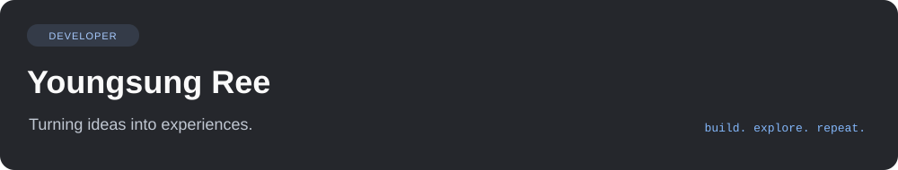

> **I am currently pursuing a master's degree.** This portfolio will be updated with research and projects from my master's studies.


Each repository's README covers the project background, development environment, and usage.

 
<a href="https://github.com/ReYoungSung/Watchers">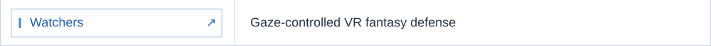</a> 
<a href="https://github.com/ReYoungSung/LegendOfXR">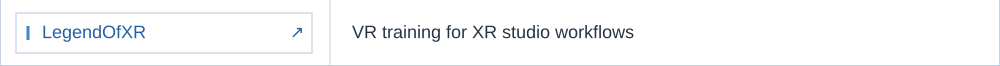</a> 
<a href="https://github.com/ReYoungSung/EyeWillCatch">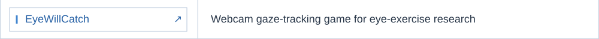</a> 
<a href="https://github.com/ReYoungSung/Wastrium">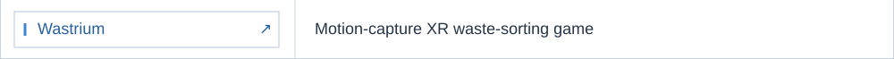</a> 
<a href="https://github.com/ReYoungSung/Last_Symphony">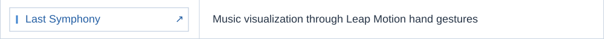</a> 
<a href="https://github.com/ReYoungSung/Graduate-Media-Art">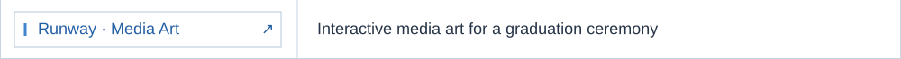</a> 
<a href="https://github.com/ReYoungSung/DropCatBlaster">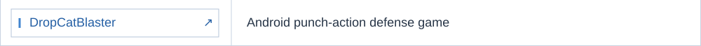</a> 
<a href="https://github.com/ReYoungSung/English_Game">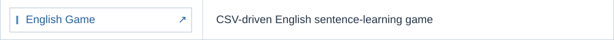</a>


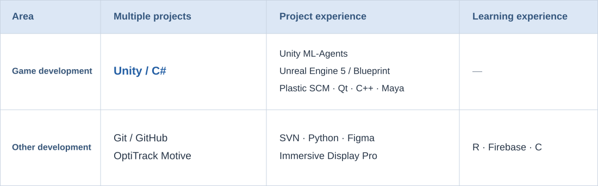

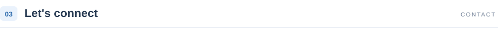

 &nbsp; <a href="mailto:sjy06238@naver.com">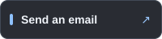</a>
