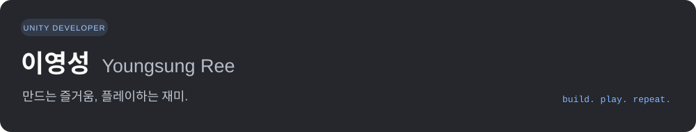

Unity와 C#을 중심으로 게임, XR 인터랙션, 미디어 아트 프로젝트를 개발해 왔습니다. 시선 추적, 손동작, 모션캡처를 콘텐츠의 입력으로 활용하는 작업을 진행했습니다.

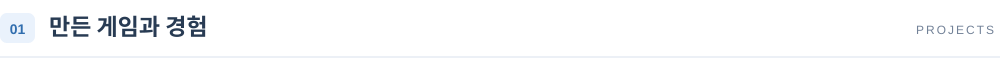

각 저장소의 README에서 프로젝트 배경, 개발 환경, 실행 방법을 확인할 수 있습니다.

 
<a href="https://github.com/ReYoungSung/Watchers">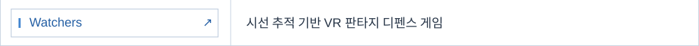</a> 
<a href="https://github.com/ReYoungSung/LegendOfXR">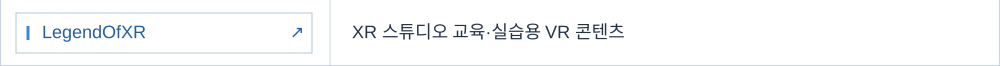</a> 
<a href="https://github.com/ReYoungSung/EyeWillCatch">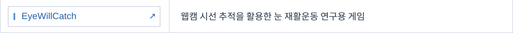</a> 
<a href="https://github.com/ReYoungSung/Wastrium">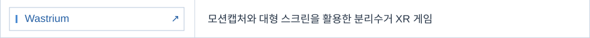</a> 
<a href="https://github.com/ReYoungSung/Last_Symphony">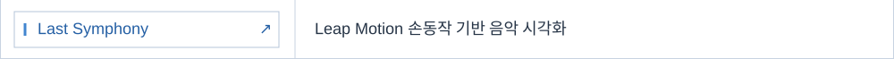</a> 
<a href="https://github.com/ReYoungSung/Graduate-Media-Art">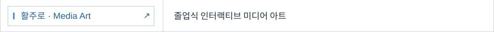</a> 
<a href="https://github.com/ReYoungSung/DropCatBlaster">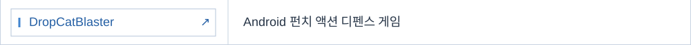</a> 
<a href="https://github.com/ReYoungSung/English_Game">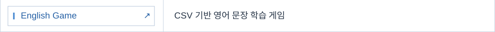</a>

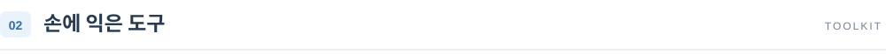

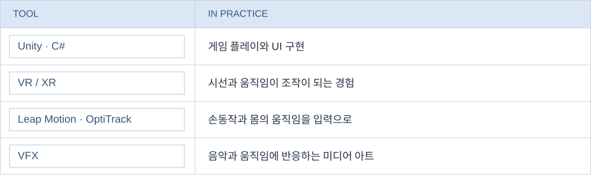

 &nbsp; <a href="mailto:sjy06238@naver.com">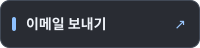</a>
