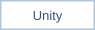
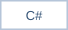
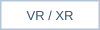
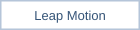
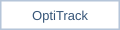
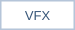

Unity와 C#을 중심으로 게임, XR 인터랙션, 미디어 아트 프로젝트를 개발해 왔습니다. 시선 추적, 손동작, 모션캡처를 콘텐츠의 입력으로 활용하는 작업을 진행했습니다.

각 저장소의 README에서 프로젝트 배경, 개발 환경, 실행 방법을 확인할 수 있습니다.

<table>
<thead>
<tr><th align="left" valign="middle">PROJECT</th><th align="left" valign="middle">PLAY EXPERIENCE</th></tr>
</thead>
<tbody>
<tr><td align="left" valign="middle"></td><td align="left" valign="middle">시선 추적 기반 VR 판타지 디펜스 게임</td></tr>
<tr><td align="left" valign="middle"></td><td align="left" valign="middle">XR 스튜디오 교육·실습용 VR 콘텐츠</td></tr>
<tr><td align="left" valign="middle"></td><td align="left" valign="middle">웹캠 시선 추적을 활용한 눈 재활운동 연구용 게임</td></tr>
<tr><td align="left" valign="middle"></td><td align="left" valign="middle">모션캡처와 대형 스크린을 활용한 분리수거 XR 게임</td></tr>
<tr><td align="left" valign="middle"></td><td align="left" valign="middle">Leap Motion 손동작 기반 음악 시각화</td></tr>
<tr><td align="left" valign="middle"></td><td align="left" valign="middle">졸업식 인터랙티브 미디어 아트</td></tr>
<tr><td align="left" valign="middle"></td><td align="left" valign="middle">Android 펀치 액션 디펜스 게임</td></tr>
<tr><td align="left" valign="middle"></td><td align="left" valign="middle">CSV 기반 영어 문장 학습 게임</td></tr>
</tbody>
</table>

<table>
<thead>
<tr><th align="left" valign="middle">TOOL</th><th align="left" valign="middle">IN PRACTICE</th></tr>
</thead>
<tbody>
<tr><td align="left" valign="middle"> </td><td align="left" valign="middle">게임 플레이와 UI 구현</td></tr>
<tr><td align="left" valign="middle"></td><td align="left" valign="middle">시선과 움직임이 조작이 되는 경험</td></tr>
<tr><td align="left" valign="middle"> </td><td align="left" valign="middle">손동작과 몸의 움직임을 입력으로</td></tr>
<tr><td align="left" valign="middle"></td><td align="left" valign="middle">음악과 움직임에 반응하는 미디어 아트</td></tr>
</tbody>
</table>

 &nbsp; 
