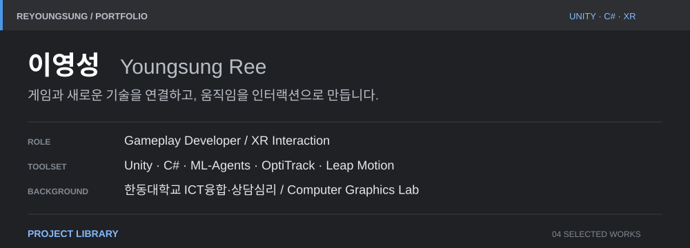
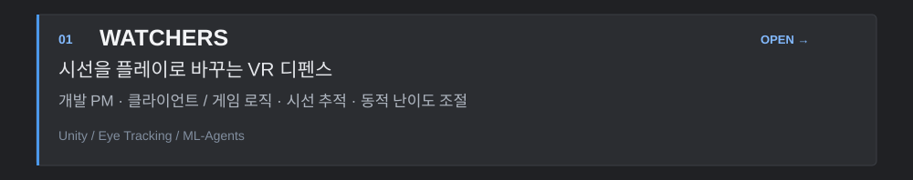
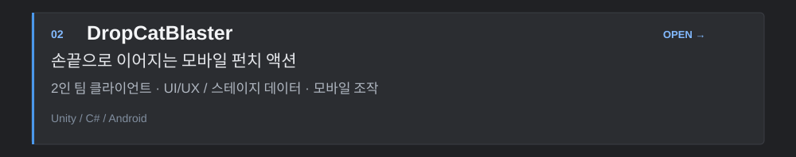
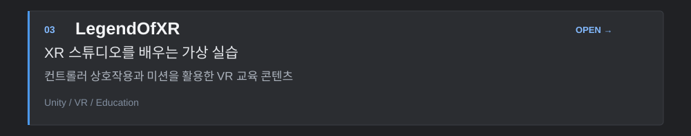
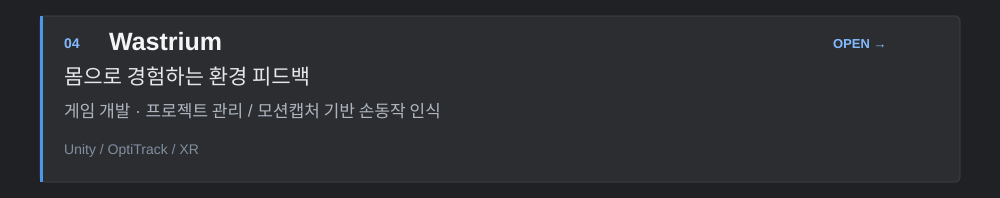
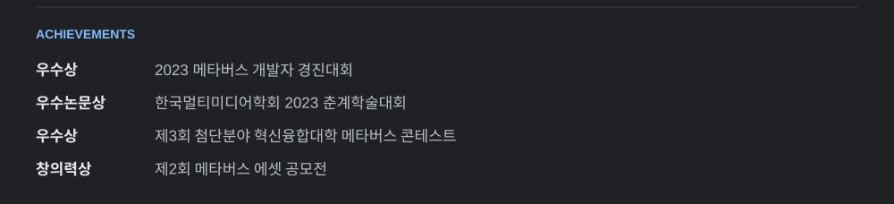
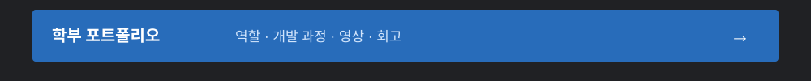

<!-- Typography panels share one palette and spacing system. Each project panel links to its repository. -->

 
 
 
 
 
 

<a href="mailto:sjy06238@naver.com">Email</a> &nbsp; / &nbsp; <a href="https://www.notion.so/4380105eeb904899824c9c479edd8035?pvs=4">추가 포트폴리오</a> &nbsp; / &nbsp; <a href="https://github.com/ReYoungSung?tab=repositories">All repositories</a>

프로젝트 상세 · 더 많은 작업 · 텍스트로 보기

## Profile

게임과 새로운 기술이 만나 재미있는 경험이 되는 순간을 좋아합니다. **Unity와 C#**을 중심으로 게임 플레이를 구현하고, 시선·손동작·모션캡처를 활용한 상호작용을 만들어 왔습니다.

- **Game development** — 게임 로직, UI/UX, 모바일 조작, 데이터 기반 스테이지 구성
- **XR interaction** — Meta Quest Pro 시선 추적, Leap Motion, OptiTrack 기반 입력
- **Research & collaboration** — 개발 PM 경험, Unity ML-Agents를 활용한 동적 난이도 조절(DDA)
- **Academic background** — 한동대학교 ICT융합·상담심리 전공, 학부 Computer Graphics Lab 활동

## EQUIPMENT · 개발 도구

<code>Unity</code> <code>C#</code> <code>XR</code> <code>ML-Agents</code> <code>OptiTrack</code> <code>VFX</code>

| 중심 기술 | 프로젝트에서 활용한 기술 |
| :--- | :--- |
| **Unity · C#** | 게임 플레이, UGUI, DOTween, JSON·CSV 데이터 구성 |
| **XR · Motion** | Meta Quest Pro, Eye Tracking, Leap Motion, OptiTrack Motive |
| **Visual & Research** | VFX, Unity ML-Agents, Unreal Engine 5 / Blueprint |
| **Collaboration** | Git · GitHub · Plastic SCM |

## SELECT PROJECT

<table>
<tr>
<td width="50%" valign="top">
<h3>01 / WATCHERS</h3>

<strong>시선을 플레이로 바꾸는 VR 디펜스</strong>

안구운동의 지속성과 흥미를 위한 판타지 게임. 개발 PM·클라이언트 프로그래머로 게임 로직과 시선 추적, ML-Agents 기반 DDA 개발에 참여했습니다.

<code>Unity</code> <code>Eye Tracking</code> <code>ML-Agents</code>

 2023 메타버스 개발자 경진대회 우수상  한국멀티미디어학회 우수논문상

<a href="https://github.com/ReYoungSung/Watchers"><strong>▶ 프로젝트 열기</strong></a> &nbsp; <a href="https://youtu.be/crsQTUlVWsM">플레이 영상 ↗</a>

</td>
<td width="50%" valign="top">
<h3>02 / DropCatBlaster</h3>

<strong>손끝으로 이어지는 펀치 액션</strong>

카툰풍 세로 스크롤 디펜스 게임. 2인 팀에서 클라이언트와 UI/UX 개발을 맡아 스테이지 데이터 관리와 모바일 조작을 구현했습니다.

<code>Unity</code> <code>C#</code> <code>Mobile</code>

 Android 베타 출시 경험  현재 배포 중단 · 개발 기록 공개

<a href="https://github.com/ReYoungSung/DropCatBlaster"><strong>▶ 프로젝트 열기</strong></a> &nbsp; <a href="https://youtu.be/w0o20lfA9vQ">플레이 영상 ↗</a>

</td>
</tr>
<tr>
<td width="50%" valign="top">
<h3>03 / LegendOfXR</h3>

<strong>XR 스튜디오를 배우는 가상 실습</strong>

XR 스튜디오 교육과 실습을 위한 VR 콘텐츠. 컨트롤러 상호작용과 미션을 통해 장비와 공간을 경험하는 교육 게임입니다.

<code>Unity</code> <code>VR</code> <code>Education</code>

 제3회 첨단분야 혁신융합대학 메타버스 콘테스트 우수상

<a href="https://github.com/ReYoungSung/LegendOfXR"><strong>▶ 프로젝트 열기</strong></a>

</td>
<td width="50%" valign="top">
<h3>04 / Wastrium</h3>

<strong>몸으로 경험하는 환경 피드백</strong>

모션캡처와 대형 스크린을 활용한 분리수거 XR 게임. 주요 게임 개발과 프로젝트 관리, 손동작 인식 구현에 참여했습니다.

<code>Unity</code> <code>OptiTrack</code> <code>XR</code>

 한국컴퓨터그래픽스학회 KCGS 2023 관련 연구 프로젝트

<a href="https://github.com/ReYoungSung/Wastrium"><strong>▶ 프로젝트 열기</strong></a>

</td>
</tr>
</table>

## MORE PROJECTS

| 프로젝트 | 경험과 인터랙션 | 핵심 입력·기술 |
| :--- | :--- | :--- |
| [**EyeWillCatch**](https://github.com/ReYoungSung/EyeWillCatch) | 눈 재활운동 연구용 게임 | 웹캠 시선 추적 |
| [**Last Symphony**](https://github.com/ReYoungSung/Last_Symphony) | 손동작으로 표현하는 음악 시각화 | Leap Motion |
| [**활주로 · Graduate Media Art**](https://github.com/ReYoungSung/Graduate-Media-Art) | 졸업식 인터랙티브 미디어 아트 | OptiTrack · VFX |
| [**English Game**](https://github.com/ReYoungSung/English_Game) | 단어를 조합하는 영어 문장 학습 | Unity · CSV |

## ACHIEVEMENTS

| 성과 | 내용 |
| :--- | :--- |
| **우수상** | 과학기술정보통신부 주최 2023 메타버스 개발자 경진대회 성인부 |
| **우수논문상** | 한국멀티미디어학회 2023 춘계학술대회 |
| **우수상** | 한국연구재단 주최 제3회 첨단분야 혁신융합대학 메타버스 콘테스트 |
| **창의력상** | 제2회 메타버스 에셋 공모전 |

프로젝트별 역할, 개발 과정, 수상 이력과 회고는 [**학부 포트폴리오**](https://maroon-beam-3eb.notion.site/115892c4c4f58067b887e470c152eb6d?source=copy_link)에 정리되어 있습니다.

---

  <em>BUILD · PLAY · ITERATE</em> 
  <a href="mailto:sjy06238@naver.com">sjy06238@naver.com</a>

