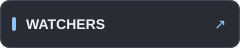
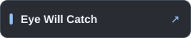
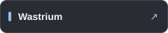
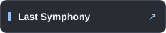
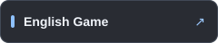

Unity와 C#을 중심으로 게임, XR 인터랙션, 미디어 아트 프로젝트를 개발해 왔습니다. 시선 추적, 손동작, 모션캡처를 콘텐츠의 입력으로 활용하는 작업을 진행했습니다.

### 🎮 만든 게임과 경험

| 프로젝트 | 어떤 경험인가요? |
| :--- | :--- |
|  | 시선 추적 기반 VR 판타지 디펜스 게임 |
|  | XR 스튜디오 교육·실습용 VR 콘텐츠 |
|  | 웹캠 시선 추적을 활용한 눈 재활운동 연구용 게임 |
|  | 모션캡처와 대형 스크린을 활용한 분리수거 XR 게임 |
|  | Leap Motion 손동작 기반 음악 시각화 |
|  | 졸업식 인터랙티브 미디어 아트 |
|  | Android 펀치 액션 디펜스 게임 |
|  | CSV 기반 영어 문장 학습 게임 |

각 저장소의 README에서 프로젝트 배경, 개발 환경, 실행 방법을 확인할 수 있습니다.

### 🛠️ 손에 익은 도구

| 도구 | 활용 |
| :--- | :--- |
|   | 게임 플레이와 UI 구현 |
|  | 시선과 움직임이 조작이 되는 경험 |
|   | 손동작과 몸의 움직임을 입력으로 |
|  | 음악과 움직임에 반응하는 미디어 아트 |

### 💬 더 이야기해요

 &nbsp; 
